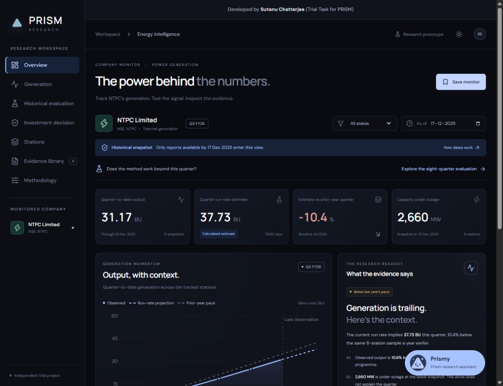

# PRISM Energy Intelligence — NTPC Research Dashboard

<p align="center"><strong>Developed by Sutanu Chatterjee (Trial Task for PRISM)</strong></p>

A React dashboard for a Prism trial project. It asks whether public station-level observations can reveal generation momentum before financial results. The design takes inspiration from Prism’s dark, restrained website. This is an independent prototype, not an official Prism or NTPC product.

The multi-quarter extension covers eight quarters, Q1 FY25 through Q4 FY26, at fixed day-45/60/75 cutoffs. At day 60, run-rate MAPE is **1.50%** versus **2.20%** for a competitive seasonal-profile baseline, winning **5 of 8** quarters. These are historical generation estimates, not stock-return forecasts. See [the reproducible study report](docs/BACKTEST_RESULTS.md).



## Dashboard guide

| Section | What it offers |
| --- | --- |
| Overview | Historical Q3 FY26 generation, run-rate estimate, comparison with programme and prior-year output, outage snapshots and an exportable research brief. |
| Generation | Observed-versus-projected chart, assumptions and a separately revealed quarter outcome. |
| Historical evaluation | Eight quarters, day-45/60/75 cutoffs, two baselines, full-quarter and remaining-output errors, per-quarter source audits and CSV exports. |
| Investment decision | Consolidated earnings, cash flow, capital spending, interest, debt and coverage; a dated market close; reported valuation ratios and editable entry-price scenarios. |
| Stations | Searchable, sortable station comparisons, state filtering, source-row inspection and CSV exports. |
| Evidence library | Preserved CEA reports, page references, availability proxies and source fingerprints. Financial sources are linked in Investment decision. |
| Methodology | Two-stream operating/financial flowchart, calculation steps, cutoff boundaries, limitations and next improvements. |

**Prismy**, the Prism research assistant, is available across the dashboard. Its custom smiling prism icon, preset questions, typed questions and source-linked evidence cards provide a guided way to explore the study. Instant mode works in a static hosted build; optional local Ollama mode matches paraphrases to the same verified cards. Public cloud LLM hosting has not been configured. The bot never displays model-written factual answers.

The interface includes dark/light themes, responsive layouts, keyboard-accessible controls and a centred developer credit at the top of every page. Saved monitors remain local to the browser.


## Run locally

Requires Node.js 20.10+ (Node 24 recommended) and npm.

```sh
npm install
npm run dev
```

Open the local URL printed in the terminal. The app uses bundled JSON and preserved PDF reports. The core dashboard and instant assistant need no account, API key, backend or live scraper. The optional local LLM uses the included development/preview middleware and a separately running Ollama service. Google Fonts is optional; system fonts are the fallback.

```sh
npm test
npm run study:export
npm run build
npm run preview
```

The production build is in `dist/`. Do not open `index.html` directly from the filesystem; use the development or preview server.

## Validation and project structure

The current suite contains **28 automated tests** covering historical cutoff isolation, source-file integrity, fiscal-year resets, baseline/error calculations, financial formulas, cash-interest classification, assistant retrieval, unsupported questions, evidence-ID validation and source links. The production build has been checked. Five optional live assistant smoke cases were also checked with the existing local Qwen model; they do not establish statistical accuracy.

| Location | Purpose |
| --- | --- |
| `src/main.jsx`, `src/styles.css` | Dashboard navigation, original monitor views, shared layout and developer credit. |
| `src/ResearchViews.jsx`, `src/backtest.js` | Multi-quarter historical evaluation and reproducible forecast/scoring logic. |
| `src/FinancialView.jsx`, `src/financials.js` | Consolidated financial analysis and valuation scenarios. |
| `src/MethodFlow.jsx` | Current NTPC research flowchart with separate operating and financial evidence. |
| `src/ResearchAssistant.jsx`, `src/PrismyIcon.jsx`, `src/knowledge.js` | Prismy interface, custom prism mascot and canonical evidence cards. |
| `src/data/` | Curated generation, backtest and financial datasets with provenance. |
| `public/sources/`, `public/research/` | Original source documents and downloadable historical results. |
| `scripts/` | Optional PDF ingestion, financial fingerprints, study exports, local LLM middleware and live assistant checks. |
| `tests/` | Reproducible automated checks. |
| `.github/workflows/deploy.yml` | Test, build and deploy the static dashboard to GitHub Pages. |

## Upload to GitHub

Upload the contents of this `ntpc-dashboard` folder as the root of a repository. Include `package-lock.json`, `src`, `public`, `tests`, `scripts`, and `.github`. Exclude `node_modules` and `dist` using the supplied `.gitignore`.

1. Create a GitHub repository and push this folder to its `main` branch.
2. In the repository, open **Settings → Pages → Build and deployment**.
3. Choose **GitHub Actions** as the source.
4. Run the included **Deploy dashboard to GitHub Pages** workflow, or push to `main`.

The workflow runs tests, builds the app and deploys `dist`. Vite uses relative asset paths so a repository subpath works without configuration. Navigation uses local React state and hash links rather than server routes, avoiding Pages refresh errors. `/#backtest` opens Historical evaluation, and `/#investment` opens Investment decision. This project has not been uploaded or published automatically.

## Working features

- Overview with observed quarter-to-date output, run-rate estimate, prior-year comparison and snapshot outages.
- Historical cutoff and state filters applied to generation observations and model inputs. Consolidated financials have their own dated context and are not station-filtered.
- Generation chart with separately labelled observed, projected and uniformly distributed prior-year reference series.
- Explicit reveal of later outcomes, isolated from prediction calculations.
- Eight-quarter retrospective replay with fixed cutoffs, two baselines, error charts, per-quarter source audits, and full-precision CSV exports.
- Investment research view with consolidated earnings, cash flow, borrowing, book value, a dated NSE close, and explicit earnings-quality flags.
- Editable valuation screen with trailing EPS, earnings haircut, assumed fair P/E and margin of safety; sourced baseline values remain separate from user scenarios. Financial history and CSV export.
- Station table, search, sorting, state filtering, programme deviation chart and CSV export.
- Evidence library with original PDFs, page references, availability metadata and SHA-256 fingerprints.
- Source inspection drawer and deterministic research brief with Markdown export.
- Methodology flowchart showing separate operating/financial evidence, historical cutoff rules, scoring boundaries and the grounded assistant.
- Floating Prismy research assistant with preset and typed questions, source citations, explicit unsupported answers, instant matching and optional free local LLM routing.
- Dark/light themes, responsive layout and browser-local saved view.

Saving a monitor only saves its cutoff and state in browser storage. It does not schedule alerts. The research brief uses local calculations, not a connected LLM.

## Data and provenance

53 unique original PDFs from the Central Electricity Authority’s National Power Portal are preserved in `public/sources/`. Each is **Generation Report for NTPC Stations, Report 9**. The original single-quarter monitor uses nine reports, and the eight-quarter study uses 48, with four shared files.

Source index: https://npp.gov.in/publishedReports

The JSON manifests `src/data/generation.json` and `src/data/backtest.json` store original source URLs, report dates, printed generation dates, availability proxies, SHA-256 hashes and selected station rows. The original monitor was retrieved on 28 October 2026 and the extension on 29 October 2026. The overview intentionally retains historical Q3 FY26 data. The separate study covers Q1 FY25–Q4 FY26 and makes its retrospective status explicit.

Original monitor endpoints:

- Prior-year baseline: 30 September and 31 December 2024.
- Current-year quarter-start reading: 30 September 2025.
- Current-year observations: 15 and 31 October, 15 and 30 November, 15 and 31 December 2025.

Eight thermal stations: Rihand, Singrauli, Korba, Sipat, Vindhyachal, Kudgi, Farakka and Talcher. This is a consistent selected sample, **not all NTPC generation**. The dataset excludes unit rows, regional subtotals, other companies and technologies. It does not claim an ownership-mapping pipeline for the whole fleet.

The data manifest preserves the CEA station spelling. Display names are shortened for readability. Raw PDFs are public-source evidence, not project-authored content. Check source terms and attribution requirements before broader redistribution.

## Financial snapshot and investment assessment

`/#investment` combines the operating research with separately sourced **consolidated** financials. It uses audited FY25/FY26 results (filed 23 May 2026), limited-review Q1 FY27 results (filed 24 July 2026), and the **28 October 2026 NSE EQ close of ₹303.75**. These are mixed-period, dated inputs captured on 29 October, not a live feed. No assertion that every newer disclosure has been ingested is made.

`src/data/financials.json` retains curated amounts, original URLs, publication dates, PDF page references, definitions and SHA-256 hashes. Two original financial PDFs and the original exchange CSV are preserved alongside the 53 CEA PDFs. The Investment decision page exposes these separately from the CEA evidence library. Values were transcribed from the consolidated statements, with cash-flow and dividend pages visually checked; tests verify source bytes and the exchange quote. For an intentional source update, review the values and run `node scripts/seal_financials.mjs` to record the new original-file hashes. This is curated ingestion, not an automated financial parser.

Key calculations:

- TTM EPS through June 2026 = FY26 ₹27.90 + Q1 FY27 ₹6.93 − Q1 FY26 ₹6.20 = **₹28.63**; reported P/E = **10.61×** at the dated close. Disclosed rounded EPS creates minor rounding differences versus exact profit/share calculations. It is not normalized EPS.
- Book value = March 2026 equity attributable to owners / crore shares = **₹209.53**; price/book = **1.45×**. Shares = ₹9,696.67 crore share capital / ₹10 face value.
- FY26 CFO **₹50,901.81 crore**, less gross cash asset purchases **₹44,049.78 crore** = **₹6,852.03 crore** before financing interest. Asset-sale proceeds are excluded from capex.
- **Interest is classified in financing.** Subtract ₹17,537.73 crore cash interest to obtain **−₹10,685.70 crore** after capex and interest. After ₹8,759.26 crore dividends paid, residual is **−₹19,444.96 crore**. This selected cash bridge excludes other investing/financing flows, asset disposals and debt repayments; it is neither the change in cash nor a complete FCFE model. Expansion capex and capitalized interest complicate comparisons with mature-business free cash flow.
- March net debt = borrowings + current/non-current leases − cash equivalents = **₹267,582.95 crore**. Other bank balances/investments are excluded. June borrowings **₹272,081.67 crore** are newer, but June cash/leases are not captured. Company debt/equity and service-coverage ratios are displayed as disclosed, with formulas and periods.
- CFO/profit uses consolidated group profit including non-controlling interests; EPS and book value use owners of the parent. These bases are labelled rather than mixed.
- FY26 indicated dividend ₹9/share includes two ₹2.75 interim distributions plus the ₹3.50 final recommendation in the May filing. Yield **2.96%** is not a forecast or verification that the final distribution was paid. Cash dividends in the cash-flow statement refer to payments during the year.

FY26 owners' profit rose 15.5% while original-filed revenue fell 0.4% and pre-tax/pre-regulatory profit fell 4.8%. A ₹7,410.21 crore deferred-tax credit interacts with regulatory deferrals; simply removing the whole credit would misstate normalized earnings. July's Q1 filing reclassifies ₹5.90 crore between FY26 revenue and other income without changing total income or profit; annual history retains the original May presentation and no mixed-presentation revenue TTM is calculated.

The research view is **watchlist / price discipline**, based on strong operating cash alongside heavy reinvestment and financing needs. It is an editorial synthesis, not a scored or backtested investment strategy. The editable example uses a **15% earnings haircut, 12× assumed fair P/E and 15% safety margin**; these are illustrations without a peer-derived calibration. Scenario EPS is ₹24.3355, assumed value ₹292.026, and entry threshold ₹248.2221. The dated ₹303.75 close does not pass this example; entering ₹200 passes the same assumptions. Neither outcome predicts investment returns. Blank/invalid inputs withhold the scenario.

Financial data never enter generation forecasts or the historical accuracy calculation. The latest earnings quarter included is June 2026; full cash-flow and balance-sheet detail is March 2026. Further work should assess recurring earnings, project returns, funding needs, regulatory economics and peers before an investment decision.

## Prismy: Prism research assistant

Click **Prismy** on any dashboard page. Six presets and typed questions cover earnings, cash flow, debt, valuation, generation, accuracy, sources and methodology. The conversation stays in memory and clears on reload. Each question is matched independently; answers use the full fixed site dataset, not the currently selected state/date or unsent valuation inputs.

The assistant deliberately renders **canonical evidence cards**, not free-form model prose. `src/knowledge.js` computes 14 cards from the same financial and historical-study JSON as the dashboard. Each answer carries source links. Instant mode uses deterministic token overlap, with conservative unknown-question handling and a small explicit scope blocklist. It is useful but can still match a question imperfectly; it is not semantic search across every PDF. There are no embeddings, external search or automatic full-document ingestion.

Optional **Local LLM** matching is available in `npm run dev` and `npm run preview` when a locally installed Ollama model is running. The existing local model detected during development is `qwen2.5:latest`. In the bot's **Answer matching** dropdown, choose the local model. No API key or paid endpoint is used. The app does not install or download a model automatically. On another computer, install Ollama and a suitable local model separately, run it locally, then start the dashboard.

The Vite-only middleware (`scripts/assistant_server.mjs`) contacts the fixed `http://127.0.0.1:11434` service, selects an installed non-cloud model, and asks it for at most two allowed evidence IDs using a JSON schema. The question is treated as data. Returned IDs are validated on both sides; the browser looks up its own answer text and citations. Model-written answers and URLs are never displayed. This bounds factual output to the curated site content even if model selection is wrong. It does not guarantee perfect relevance. Unsupported selections get an evidence-gap response; unavailable/slow models fall back to instant matching with a visible notice. Requests have size limits, timeouts and a same-origin check. There is no chat database or configured request logging.

The integration follows the [Ollama chat API](https://docs.ollama.com/api/chat) and its structured-output schema. The local LLM can improve matching of paraphrased questions without being allowed to invent financial facts. Only the current question and evidence catalog are sent to the local service; conversation history is not sent. A cloud-hosted deployment would need a separately secured backend to support an LLM. **GitHub Pages runs instant mode only**, with no secret keys in the browser. The production build does not include a model server.

Run `npm test` for deterministic retrieval, unknown-scope, ID-validation, source-link, source-change and middleware-origin checks. With local Ollama and the dev server running, `npm run assistant:eval` runs a small live routing smoke evaluation. The five live smoke cases passed with the local Qwen model during the 29 October 2026 update, after refining the catalog to distinguish historical forecast accuracy from unsupported future price predictions. This is a functional check, not a statistical claim about answer accuracy.

Prismy uses a custom code-native SVG mascot: a rounded pastel prism with a smiling face and sparkles. Its name, launcher, welcome, accessibility labels and methodology reference use Prism branding.

The Methodology flowchart is responsive HTML/CSS with real text and accessible headings. It reflects the current NTPC financial extension, rather than the earlier DMart concept diagram.

## Original monitor method

Quarter: 1 October–31 December 2025, or Q3 FY26, with 92 calendar days.

1. Include only reports with `availableAt <= cutoff` and `date <= cutoff`.
2. Define availability conservatively as one day after the **report-generation date printed in the PDF**. This avoids intraday leakage but does not verify when a report first became publicly accessible.
3. Match the same station IDs in all endpoints.
4. Calculate quarter-to-date MU as fiscal YTD MU at the observation minus fiscal YTD MU on 30 September 2025.
5. Calculate run-rate projection as QTD MU / elapsed quarter days × 92.
6. Use the same stations’ October–December 2024 output as a seasonal naive baseline. On the chart, distribute this prior-year total evenly over 92 days as a reference, not measured daily history.
7. Use 31 December 2025 output only in the separately revealed retrospective evaluation. Signed percentage error is `(estimate / actual - 1) * 100`.

1,000 MU = 1 BU. Programme deviation uses cumulative QTD actual versus cumulative QTD programme. Outages and capacity are snapshot values in MW. The app never treats a one-day outage observation as a causal explanation for quarter-wide output.

## Limitations and next steps

- Eight studied quarters, a small selected thermal sample and sparse snapshots do not establish durable forecasting skill. The original Overview remains a single-quarter historical monitor.
- CEA revisions and inconsistent fiscal-YTD endpoints may affect calculated changes. Files have hashes, but a revision-history system is not implemented.
- Availability dates are proxies. Archived first-seen timestamps are needed for a rigorous point-in-time backtest.
- A constant run rate ignores seasonality within the quarter, dispatch changes, weather, fuel, maintenance and commissioning.
- CEA programme is an operating plan, not analyst consensus.
- The run-rate method does not always beat the seasonal profile. At day 60 the profile wins three quarters. Small error differences are not evidence of economically significant skill.
- No revenue forecast, stock-return model, live data feed or LLM output is implied. The financial view supplies a dated research assessment and a conditional price screen, not a validated buy/sell model.
- Next: longer vintage-controlled history, complete legal-entity mapping, prospective holdout quarters, normalized consolidated earnings, financing/commissioning scenarios, peer valuation and a full financial model of tariff and availability payments.

## Eight-quarter replay method

`src/data/backtest.json` defines the study protocol and captured observations. Eight quarters run from April 2024 to March 2026. Three fixed cutoffs fall on quarter days 45, 60 and 75. Captures fall on days 40, 55 and 70. The newest captured report passing its cutoff provides the observation. This is a sparse archive, not every daily report.

- **Run rate:** current QTD generation / elapsed days × full-quarter days.
- **Seasonal profile:** current QTD generation × prior-year full-quarter generation / prior-year QTD generation on the same calendar date. This stronger baseline uses the current observation too.
- **Unchanged prior-year total:** repeat the prior-year quarter's generation.
- **Fiscal reset:** April quarters use zero as the fiscal-year starting value. Other quarters subtract the previous quarter-end cumulative value. Leap-year dates and quarter lengths are handled explicitly.
- **Error metrics:** MAPE, MAE, WAPE, signed bias, wins against each comparator and the sign of year-on-year output change. MAPE weights quarters equally. The forecast errors use full precision even when displayed BU values round to two decimals.
- **Separation:** prediction reads only eligible reports. Scoring reads the final outcome separately. Later-outcome poisoning tests verify predictions remain unchanged.

The UI shows all three cutoffs and all losses. The 24 forecast/outcome comparisons represent eight quarters, not 24 independent periods. Availability uses a printed-date proxy, so this is not a verified vintage-perfect point-in-time backtest. No coefficients are fitted or optimized. Day 60 is the fixed main comparison, with all cutoff sensitivities visible.

At day 60, the captures contain 55 days of observed output. On only the remaining, unobserved output, run-rate MAPE is **3.81%** versus **5.54%** for the seasonal profile. The 1.50% headline includes the already observed part of the quarter. Error percentages are not probabilities of making a correct investment decision.

State-scoped seasonal ratios are computed independently within that scope. Their forecasts need not sum to the all-state seasonal forecast because the ratio is nonlinear.

`docs/BACKTEST_RESULTS.md` and three `docs/backtest-day-*.csv` files are reproducible exports. The source audit for each quarter links every input report and labels the later outcome separately.

## Optional refresh

The dashboard runs entirely with JavaScript. Python is needed only to rerun source ingestion:

```sh
python -m pip install pypdf
python scripts/ingest.py
python scripts/ingest_backtest.py
npm run study:export
```

The ingest script downloads the fixed historical endpoints and fails if a station is missing or duplicated. Existing PDF files are reused to preserve the captured vintage. After intentional refresh, inspect source rows and metadata, then run tests and rebuild. Source capture does not verify first public appearance.

## How it addresses the trial brief

| Requirement | Project response |
| --- | --- |
| Define the problem | Assess early generation momentum and connect it to a transparent, separately dated financial research view. |
| Working prototype | Public PDFs, a consistent station sample, dated cutoffs, multi-quarter evaluation, consolidated financial analysis and a bounded question assistant. |
| Present the result | Dashboard, error comparisons, cash-flow bridge, conditional entry-price screen, source-linked answers, research brief, flowchart and CSV exports. |
| Document the work | Source manifests, reproducible setup and exports, 28 tests, assistant smoke checks, methodology, assumptions, limitations and next steps. |

## Observations and further work

- A strong operating model is not automatically an investment model: generation accuracy does not establish earnings accuracy or stock returns.
- The seasonal-profile baseline is harder to beat than repeating the prior-year total; full-quarter accuracy also benefits from already observed output. The remaining-output error makes that distinction visible.
- Cash interest appears under financing in NTPC’s cash-flow statement. Treating CFO minus capex as equity cash would overstate funds available to shareholders.
- Deferred tax and regulatory movements interact. Removing a single headline adjustment would not establish recurring consolidated earnings.
- Allowing an LLM to select evidence IDs, while rendering canonical answers, constrains factual output. Matching relevance still needs broader evaluation.

Before production use, prioritise verified first-public timestamps, a broader legal-entity/station map, prospective holdout quarters, recurring-earnings and financing scenarios, peer comparisons, and a larger assistant evaluation set. Hosted LLM support remains a separate future integration requiring an appropriate backend and service account.

The older DMart flowchart and presentation in the parent project folder describe the initial proposal. The current software is the NTPC project; its up-to-date flowchart is in Methodology. No remote repository or public deployment has been created automatically.
